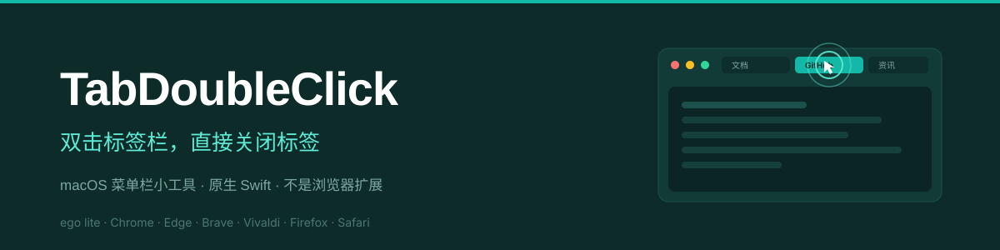
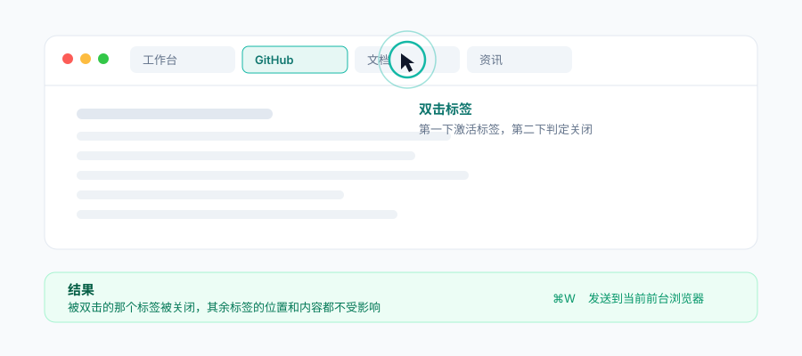
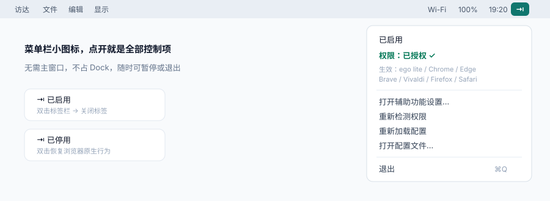
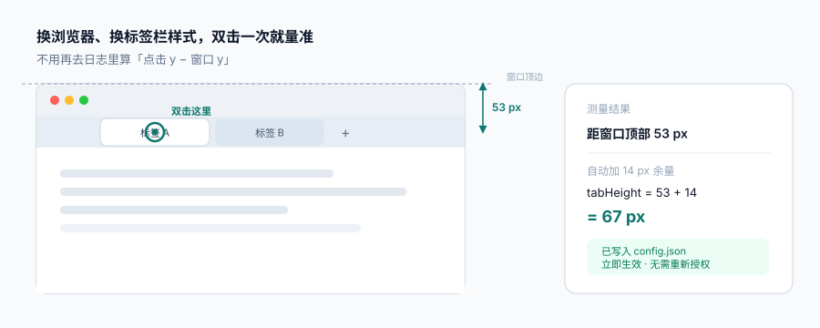
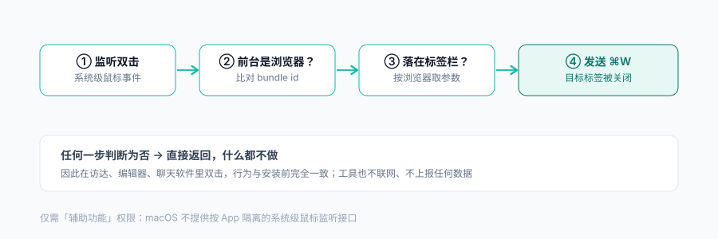

<div align="center">



<br>

**在浏览器标签栏上双击左键，直接关掉那个标签。**

像 360、QQ 浏览器的老习惯一样顺手，但这次 macOS 上的 Chrome、Edge、Safari、ego lite、Arc、Firefox 等 **26 款浏览器**全都能用。

<br>


[](https://github.com/chunsanyue-rgb)

[功能特性](#-功能特性) · [演示](#-效果) · [安装](#-安装) · [首次授权](#-首次授权必看) · [配置](#-配置) · [FAQ](#-常见问题) · [原理](#-工作原理) · [作者](#-作者)

</div>

---

## 🤔 为什么需要它

macOS 上的浏览器都**没有**「双击标签关闭」这个选项——Chrome 系从 2008 年到现在都没做，Safari 也没有。想关标签只能中键点、按 `⌘W`、或者去点那个很小的 `×`。

而浏览器**扩展 API 根本碰不到标签栏**：`chrome.tabs` 能操作标签，但收不到标签栏上的鼠标事件，因为标签栏是浏览器的原生 UI，不属于网页。所以 Vivaldi、360、QQ 浏览器能用，是因为它们在浏览器内核层自己实现了，**任何扩展都做不到**。

这个项目用另一条路解决：一个 100KB 的 macOS 原生小工具，**站在浏览器外面**看鼠标事件，判断"你是不是在标签栏上双击"，是就替你按一下 `⌘W`。

| 常见方案 | 能否实现双击标签关闭 |
| --- | :---: |
| Chrome / Safari 自带设置 | ❌ 没有这个选项 |
| 浏览器扩展（含商店里的同类扩展） | ❌ 扩展无法访问标签栏 |
| 鼠标手势类软件（BetterTouchTool 等） | ⚠️ 需要复杂配置，且不区分标签栏位置 |
| **本项目** | ✅ 原生实现，装在菜单栏即用 |

---

## ✨ 功能特性

| | 特性 | 说明 |
| --- | --- | --- |
| 🖱️ | **双击标签即关闭** | 第一下点击激活标签，第二下判定关闭，符合直觉 |
| 🌐 | **26 款浏览器开箱即用** | ego lite / Chrome / Edge / Brave / Vivaldi / Opera / Firefox / Safari / Arc / Chromium / Zen / Orion…，谁在前台就作用于谁 |
| 🎯 | **一键校准** | 任何浏览器、任何标签栏布局，双击一次就自动量出真实位置并写入配置 |
| 📊 | **关闭统计** | 菜单里直接看今日 / 累计关了多少个标签 |
| 🎛️ | **精确区域判定** | 只有落在「标签栏」区域才动作，网页正文里双击毫无影响 |
| 🛡️ | **绝不误伤其他 App** | 非浏览器前台时，全局监听直接返回，行为与安装前完全一致 |
| ⚙️ | **参数可配置** | 标签栏高度、左侧避让、冷却时间写进 JSON，改完即时生效，不用重编译 |
| 🔒 | **不联网、零上报** | 代码里没有任何网络调用，日志只写本地文件（自动轮转，不超过 512 KB） |
| 🪶 | **极轻量** | 单个可执行文件约 150 KB，常驻内存几 MB |
| 🧩 | **无 Dock 图标** | 菜单栏 `⇥` 图标，随时暂停 / 退出 |
| 🍎 | **纯原生 · Universal** | Swift + Cocoa + Accessibility API，无第三方依赖，Apple 芯片与 Intel 同一个包 |

---

## 🎬 效果

<div align="center">

</div>

---

## 📦 安装

### 方式一：下载现成安装包（推荐）

1. 到 [Releases](../../releases) 下载最新的 `TabDoubleClick-x.x.x.zip`
2. 解压后把 `TabDoubleClick.app` 拖进 `~/Applications`（或「应用程序」）
3. 打开终端执行一次，去掉系统隔离标记（非公证应用必须做，否则提示"已损坏"）：

```bash
xattr -dr com.apple.quarantine ~/Applications/TabDoubleClick.app
```

4. 双击启动，然后按下面的[首次授权](#-首次授权必看)操作

> 想省事也可以用 Release 里附带的 `install.sh`：`bash install.sh` 会自动完成 2~4 步。

### 方式二：源码编译（需要 Xcode 命令行工具）

```bash
git clone https://github.com/chunsanyue-rgb/TabDoubleClick.git
cd TabDoubleClick

# 一键编译 + 安装 + 启动
make install
```

只编译不安装：

```bash
make build      # 产物在 build/TabDoubleClick.app
make dist       # 打包成 dist/TabDoubleClick-1.1.0.zip
```

首次编译前如提示找不到 `swiftc`：

```bash
xcode-select --install
```

### 方式三：自己改代码

源码只有一个文件 —— [`Sources/main.swift`](Sources/main.swift)，503 行，无第三方依赖，改完 `make install` 即可。

---

## 🔐 首次授权（必看）

> **这一步不做，工具完全不工作。** 90% 的"双击没反应"都是卡在这里。

工具需要 **辅助功能（Accessibility）** 权限——因为 macOS 不提供"只监听某个 App 的鼠标事件"的接口，系统级的监听必须授权。

1. 首次启动会弹出系统授权框 → 点「打开系统设置」
   （没弹的话：菜单栏点 `⇥` → 「打开辅助功能设置…」）
2. 进入 **系统设置 → 隐私与安全性 → 辅助功能**
3. 找到 **TabDoubleClick**，打开右侧开关
4. **此时会弹出带锁的密码框 → 输入开机密码 → 点「修改设置」**

> ⚠️ **第 4 步是最大的坑**：只拨开关、不输密码，系统不会保存授权。很多人就是卡在这，开关看着是开的，实际没生效。
> 如果列表里已有该项且开关已开却不生效，请**关掉再打开一次**，然后完成密码解锁。

5. 授权后工具每 2 秒自动检测，**无需重启**；菜单栏点 `⇥` 看到「权限：已授权 ✓」即成功

### 开机自启（可选）

系统设置 → **通用** → **登录项与扩展** → 点 `+` → 选择 `~/Applications/TabDoubleClick.app`

> 注：本项目不使用 LaunchAgent（新版 macOS 对未公证程序的 LaunchAgent 一律拒绝加载），登录项是最稳妥的方式。

---

## 🖥️ 菜单栏

<div align="center">

</div>

菜单里可以直接：暂停 / 恢复、看权限状态、**看当前前台浏览器的适配情况**、**看今日与累计关闭数**、一键校准、重载配置、打开配置文件 / 日志、退出。

---

## 🌐 支持的浏览器

开箱即用，**谁在最前面就作用于谁**：

| 系 | 浏览器 | bundle id | 标签栏高度 | 全屏可用 |
| --- | --- | --- | :---: | :---: |
| Chromium | **ego lite** | `com.citrolabs.ego.lite` | 40 | ✅ |
| Chromium | Google Chrome（稳定版 / Beta / Dev / Canary） | `com.google.Chrome[.beta/.dev/.canary]` | 40 | ✅ |
| Chromium | Chromium | `org.chromium.Chromium` | 40 | ✅ |
| Chromium | Microsoft Edge（稳定版 / Beta / Dev / Canary） | `com.microsoft.edgemac[.Beta/.Dev/.Canary]` | 40 | ✅ |
| Chromium | Brave（稳定版 / Beta / Nightly） | `com.brave.Browser[.beta/.nightly]` | 40 | ✅ |
| Chromium | Vivaldi | `com.vivaldi.Vivaldi` | 40 | ✅ |
| Chromium | Opera（稳定版 / GX / Beta） | `com.operasoftware.Opera[GX/Next]` | 40 | ✅ |
| Chromium | Arc | `company.thebrowser.Browser` | 44 | ✅ |
| Gecko | Firefox（稳定版 / Developer / Nightly） | `org.mozilla.firefox[developeredition/nightly]` | 42 | ✅ |
| Gecko | Zen Browser | `io.github.zen_browser.zen` | 46 | ✅ |
| WebKit | Safari | `com.apple.Safari` | 42 | ❌ |
| WebKit | Safari Technology Preview | `com.apple.SafariTechnologyPreview` | 42 | ❌ |
| WebKit | Orion | `com.kagi.kagimacOS` | 42 | ❌ |
| WebKit | DuckDuckGo | `com.duckduckgo.macos.browser` | 44 | ✅ |

> **上表的数字只是默认值，不是"真理"。** 同一个浏览器换个标签栏样式（Safari 的「紧凑 / 独立」、Chrome 的垂直标签栏、Firefox 的标题栏模式）位置就会变。所以从 v1.1.0 起不用再手算像素了 —— 用「一键校准」量一次就好，见下一节。

### 不在列表里的浏览器（Thorium、Sidekick、360、QQ…）

直接点 `⇥` →「校准当前浏览器的标签栏…」，双击一次标签栏，工具会自动把这款浏览器加入配置。**不需要改代码，也不需要重新授权。**

---

## 🎯 一键校准（v1.1.0 新增）

这是这一版最重要的一件事：以前换了浏览器或换了标签栏样式，要去日志里算"点击 y − 窗口 y"，很折腾。现在只需三步：

1. 把目标浏览器切到最前面
2. 点菜单栏 `⇥` → **「校准当前浏览器的标签栏…」**，点「好」
3. 20 秒内，在**标签栏上任意一个标签**双击左键（这次双击只用于测量，不会关闭标签）

<div align="center">

</div>

工具会算出「该点击距窗口顶部多少像素」，加上 14 px 的余量写入 `config.json`，立即生效，并弹窗告诉你结果：

```
校准完成 ✅
Safari：标签栏高度 88px，左侧避让 12px。
```

> 校准是纯配置操作，**不涉及程序文件**，所以永远不会让你重新授权。点偏了重新校准一次即可。

---

## ⚙️ 配置

配置文件路径：

```
~/Library/Application Support/TabDoubleClick/config.json
```

菜单栏 `⇥` → 「打开配置文件…」可直接打开；改完点「重新加载配置」**即时生效，不用重编译、不用重新授权**。

```json
{
  "_settings" : {
    "cooldown" : 0.4,
    "sound"    : false
  },
  "com.google.Chrome" : {
    "name"           : "Chrome",
    "tabHeight"      : 40,
    "leftInset"      : 80,
    "allowFullscreen": true
  },
  "com.apple.Safari" : {
    "name"           : "Safari",
    "tabHeight"      : 88,
    "leftInset"      : 12,
    "allowFullscreen": false
  }
}
```

### 全局设置 `_settings`

| 字段 | 类型 | 默认 | 含义 |
| --- | --- | :---: | --- |
| `cooldown` | 秒 | `0.4` | 两次关闭之间的最短间隔，防止手抖连击误关多个标签 |
| `sound` | 布尔 | `false` | 关闭时播放一声轻提示音（`Tink`） |

### 每款浏览器

| 字段 | 含义 |
| --- | --- |
| `name` | 菜单与日志中显示的名字 |
| `tabHeight` | 从窗口顶部往下多少像素算「标签栏」 |
| `leftInset` | 左侧避让宽度，避开红绿灯按钮 |
| `allowFullscreen` | 全屏时是否仍允许双击关闭 |

### 参数不准怎么办

**先试「一键校准」**，90% 的情况一次就准。要手调或想搞清原理，看日志：

```bash
tail -f ~/Library/Logs/TabDoubleClick.log
```

每次双击都会记录一行：

```
[2026-11-05 19:41:02] Safari 双击 点=(1722,321) 距顶=67px 窗口=(629,254,1324x940) 全屏=false 命中=false
```

- `距顶=67px` 就是标签栏在窗口内的实际位置，把 `tabHeight` 调到 `67 + 14 = 81` 以上即可
- 左侧标签点不到 → 调小 `leftInset`
- 日志超过 512 KB 自动轮转为 `TabDoubleClick.log.1`，不会无限增长

### 新增一个浏览器（手动）

```bash
osascript -e 'id of app "Arc"'   # 查 bundle id
```

把它作为新键加进 `config.json`，填上参数，点「重新加载配置」即可。更省事的做法是用一键校准，它会自动帮你生成这一项。

---

## 🧠 工作原理

<div align="center">

</div>

```
全局鼠标事件  →  前台 App 是受支持的浏览器吗？  →  双击点在标签栏区域吗？  →  发送 ⌘W
                        ↓ 否                              ↓ 否
                     直接返回                          直接返回
```

- **监听**：`NSEvent.addGlobalMonitorForEvents(matching: .leftMouseDown)`
- **定位**：`AXUIElementCreateApplication` 取窗口 frame 与 `AXFullScreen` 状态
- **判定**：光标所在的窗口 + 顶部 N 像素区间 + 左右避让
- **动作**：`CGEvent` 合成 `⌘W`（此时双击已激活目标标签，所以关的正是它）

**隐私说明**：工具只读取"点击坐标"和"窗口位置"用于判断，不记录点击内容、不读取网页、不联网、不写任何远程数据。

---

## ❓ 常见问题

<details>
<summary><b>双击了但标签没关？</b></summary>

按顺序排查：

1. 菜单栏 `⇥` 里是否显示「已启用」且「权限：已授权 ✓」
2. 是不是在**浏览器前台**（其他 App 前面时本就不生效）
3. 双击位置是否在**窗口顶部标签栏**，而不是网页正文
4. 看日志 `tail -f ~/Library/Logs/TabDoubleClick.log`：
   - 没有日志 → 权限没生效，回去做[首次授权](#-首次授权必看)（记得输密码）
   - 有日志但 `命中=false` → 参数没对上，点 `⇥` →「校准当前浏览器的标签栏…」重校一次，或按[参数不准怎么办](#参数不准怎么办)调 `tabHeight`

</details>

<details>
<summary><b>提示「应用已损坏，无法打开」？</b></summary>

不是文件坏了，是 Gatekeeper 对非公证应用的隔离标记。执行：

```bash
xattr -dr com.apple.quarantine ~/Applications/TabDoubleClick.app
```

或右键 App → 打开 → 再点「打开」。

</details>

<details>
<summary><b>为什么必须要辅助功能权限？会不会有风险？</b></summary>

macOS 的系统级鼠标监听只有拿到辅助功能权限才能用，没有更细粒度的授权方式（这是系统限制，所有同类工具都一样）。

风险层面：本项目完全开源，只有一个文件 503 行，你可以逐行审查——里面没有任何网络请求、没有文件读取、没有数据上报，只做「判断坐标 → 发一个 ⌘W」。

</details>

<details>
<summary><b>会影响其他 App 吗？</b></summary>

不会。每次双击都会先判断前台 App 的 bundle id，不在支持列表里就直接返回。在访达、VS Code、微信、终端里双击，行为和安装前完全一致。

</details>

<details>
<summary><b>双击「+」新建标签按钮会怎样？</b></summary>

第一下点击会新建一个标签，第二下判定在标签栏内，于是把这个刚建的空标签关掉。视觉上几乎无感。目前不特殊处理，属于已知的极小副作用。

</details>

<details>
<summary><b>Chrome 里双击标签栏空白处会新建标签，会冲突吗？</b></summary>

Chrome 在标签栏空白处双击确实会新建标签，但同时本工具也会判定命中并关闭当前标签，两者可能互相干扰。建议只双击**标签本身**，不要双击标签右侧的空白区（Roadmap 里有一条「只识别标签按钮区域」，需要靠 AX 逐个读标签位置，还没做）。

</details>

<details>
<summary><b>重装 / 升级后授权失效了？</b></summary>

正常。辅助功能授权绑定的是**程序指纹**，程序文件一变，系统就当成新程序。重新按[首次授权](#-首次授权必看)操作一次即可（记得输密码解锁）。

> 这也是本项目把可调参数外置到 `config.json` 的原因：**改参数不要碰程序**，就不用反复授权。

</details>

<details>
<summary><b>Intel Mac 能用吗？</b></summary>

可以。从 v1.1.0 起 Release 里提供的是 **Universal 通用二进制**（arm64 + x86_64），Intel Mac 直接下载解压即可，不需要自己编译。

如果你的 Intel Mac 是很老的系统（macOS 12 以下），请自行编译：

```bash
git clone https://github.com/chunsanyue-rgb/TabDoubleClick.git && cd TabDoubleClick
make install
```

</details>

<details>
<summary><b>怎么彻底卸载？</b></summary>

```bash
make uninstall
```

然后到 系统设置 → 隐私与安全性 → 辅助功能，选中 TabDoubleClick 点 `−`。
配置文件如也要清掉：`rm -rf ~/Library/Application\ Support/TabDoubleClick`。

</details>

---

## 🗺️ Roadmap

- [x] 多浏览器自动适配（26 款）
- [x] 参数外置为配置文件
- [x] 菜单栏控制中心
- [x] **一键校准标签栏**（v1.1.0）
- [x] **关闭数量统计**（v1.1.0）
- [x] **Universal 二进制，Intel 原生支持**（v1.1.0）
- [x] 日志自动轮转（v1.1.0）
- [ ] 精确识别"标签按钮"区域，彻底避开标签栏空白处（需 AX 逐标签读取）
- [ ] 菜单里逐浏览器开关
- [ ] 竖排标签栏 / 侧边栏模式适配（Arc、Edge、Vivaldi）
- [ ] 中键单击标签关闭（作为双击的补充）
- [ ] Homebrew tap：`brew install --cask tabdoubleclick`
- [ ] Apple 开发者签名 + 公证，彻底免去 `xattr` 一步

有想法欢迎开 issue。

---

## 📁 项目结构

```
TabDoubleClick/
├── Sources/main.swift              # 全部源码（503 行，无第三方依赖）
├── Resources/
│   ├── Info.plist                  # App 包信息
│   └── config.example.json         # 配置示例
├── scripts/
│   ├── build.sh                    # 编译 + 组装 + 签名
│   └── install.sh                  # 安装到 ~/Applications 并启动
├── docs/                           # README 配图（SVG）
├── .github/workflows/build.yml     # CI：自动编译 + tag 时发布 Release
├── Makefile                        # make build / install / dist / uninstall
├── LICENSE                         # MIT（英文原文）
└── LICENSE.zh-CN.md                # MIT 中文参考译文
```

---

## 🛠️ 开发

```bash
make build      # 编译
make install    # 安装并启动
make dist       # 打包 zip
make uninstall  # 卸载
make clean      # 清理产物
make help       # 查看全部命令
```

CI 会在每次 push 时于 `macos-latest` 上完整编译、校验签名并产出 zip；打 `v*` tag 时自动发布到 Releases。

想调参与调试：日志是 `tail -f ~/Library/Logs/TabDoubleClick.log`，每次双击都会记录坐标、窗口范围与命中结果。

---

## 🤝 贡献

欢迎 issue 和 PR。提交前请确认：

- [ ] `make build` 能通过
- [ ] 改动了判定逻辑的，说明测试过的浏览器与版本
- [ ] 不要提交 `*.pem` / `*.p12` 等签名文件（已在 `.gitignore` 中）

---

## 👤 作者

<div align="center">

<a href="https://github.com/chunsanyue-rgb">
  
</a>

### chunsanyue

<sub>把「用着不顺手」改成「顺手」的人</sub>

<br>

[](https://github.com/chunsanyue-rgb)
[](https://github.com/chunsanyue-rgb/TabDoubleClick/stargazers)
[](https://github.com/chunsanyue-rgb/TabDoubleClick/issues)

</div>

这个项目起因于一个很具体的小别扭：在 macOS 上换了十几个浏览器，**没有一款**能像 360、QQ 浏览器那样双击标签就关掉，扩展 API 又碰不到标签栏。既然没有，那就自己写一个——于是有了这个 100 KB 的菜单栏小工具。

| 项目 | 信息 |
| --- | --- |
| 作者 | **chunsanyue** |
| GitHub | [@chunsanyue-rgb](https://github.com/chunsanyue-rgb) |
| 项目主页 | [chunsanyue-rgb/TabDoubleClick](https://github.com/chunsanyue-rgb/TabDoubleClick) |
| 问题反馈 | [Issues](https://github.com/chunsanyue-rgb/TabDoubleClick/issues/new) — 提之前建议先看一眼 [FAQ](#-常见问题) |
| 开源协议 | [MIT](LICENSE) · 英文原文 / [中文参考译文](LICENSE.zh-CN.md) © 2026 chunsanyue |
| 使用成本 | 免费、无广告、不联网、零上报 |

> 想加新的浏览器适配、或者遇到双击没反应，直接在 Issues 里说清楚**浏览器名字 + 版本 + 日志最后几行**（`tail -20 ~/Library/Logs/TabDoubleClick.log`），一般都能很快定位。

---

## 📄 License

本项目基于 [MIT 许可证](LICENSE) 开源 © 2026 **chunsanyue**

- 授权条款：[LICENSE](LICENSE)（英文原文，具法律效力）
- 中文译文：[LICENSE.zh-CN.md](LICENSE.zh-CN.md)（仅供参考，如有歧义以英文原文为准）
- 你可以自由使用、修改、分发、商用，**保留版权声明即可**
- 软件按「原样」提供，不附带任何担保

---

<div align="center">

**如果这个小工具帮你省下了每天几十次的 `⌘W`，点个 ⭐️ 就是最好的支持**

<sub>Made with ☕ by <a href="https://github.com/chunsanyue-rgb">chunsanyue</a> · MIT License</sub>

<sub>本项目与 Google、Apple、Citro Labs 等公司无任何关联。</sub>

</div>
