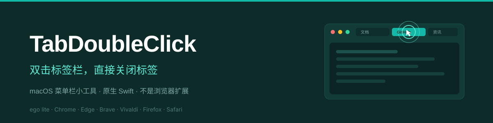

# TabDoubleClick

**Double-click a browser tab to close it — the way 360/QQ browsers do it, but on macOS.**

[中文文档](README.md)

<div align="center">

</div>

## Why

No macOS browser offers "double-click a tab to close it", and browser extensions **cannot** do it either — the tab strip is native browser UI, outside the `chrome.tabs` API's reach. This project takes a different route: a ~100 KB native menu-bar app that watches mouse events *outside* the browser and presses `⌘W` for you when you double-click a tab.

## Features

- Double-click a tab → it closes (first click activates, second click closes)
- Auto-detects the frontmost browser: ego lite, Chrome, Chrome Canary, Edge, Brave, Vivaldi, Firefox, Safari
- Only acts inside the tab-strip region — double-clicks in page content are ignored
- Zero effect on other apps; no network access; logs stay local
- Tunable geometry via `config.json` (applies instantly, no rebuild, no re-authorization)
- Menu-bar only, no Dock icon, no third-party dependencies

## Install

```bash
git clone https://github.com/chunsanyue-rgb/TabDoubleClick.git
cd TabDoubleClick
make install
```

Or download the zip from [Releases](../../releases), drop the app in `~/Applications`, then:

```bash
xattr -dr com.apple.quarantine ~/Applications/TabDoubleClick.app
```

## Required permission

Accessibility (辅助功能) is mandatory — macOS offers no per-app global mouse monitoring.

1. Launch the app, click "Open System Settings" in the prompt
2. System Settings → Privacy & Security → Accessibility → enable **TabDoubleClick**
3. **Enter your login password and click "Modify Settings"** — skipping this step means the grant is never saved (the #1 reason it "doesn't work")

No restart needed; the app polls every 2 seconds.

## Configuration

`~/Library/Application Support/TabDoubleClick/config.json`

```json
{
  "com.apple.Safari" : { "name": "Safari", "tabHeight": 88, "leftInset": 12, "allowFullscreen": false }
}
```

- `tabHeight` — pixels from the window top that count as the tab strip
- `leftInset` — pixels to skip on the left (traffic lights)
- Menu: `⇥` → "Reload config" applies changes immediately

Debug with `tail -f ~/Library/Logs/TabDoubleClick.log` — every double-click logs hit coordinates, window frame, and whether it matched.

## Build

```bash
make build      # build only
make dist       # zip for distribution
make uninstall  # remove
```

Requires Xcode Command Line Tools (`xcode-select --install`). CI builds on `macos-latest` and publishes releases on `v*` tags.

## Author

<div align="center">

<a href="https://github.com/chunsanyue-rgb">
  
</a>

### chunsanyue

<sub>Someone who turns "annoying to use" into "just works"</sub>

<br>

[](https://github.com/chunsanyue-rgb)
[](https://github.com/chunsanyue-rgb/TabDoubleClick/issues)

</div>

| | |
| --- | --- |
| Author | **chunsanyue** |
| GitHub | [@chunsanyue-rgb](https://github.com/chunsanyue-rgb) |
| Repository | [chunsanyue-rgb/TabDoubleClick](https://github.com/chunsanyue-rgb/TabDoubleClick) |
| Feedback | [Issues](https://github.com/chunsanyue-rgb/TabDoubleClick/issues/new) |
| License | [MIT](LICENSE) © 2026 chunsanyue · [中文译文](LICENSE.zh-CN.md) |

## License

Released under the [MIT License](LICENSE) © 2026 **chunsanyue**.

A Chinese reference translation is available at [LICENSE.zh-CN.md](LICENSE.zh-CN.md); the English text is authoritative.

---

<div align="center">

<sub>Made with ☕ by <a href="https://github.com/chunsanyue-rgb">chunsanyue</a> · MIT License</sub>

</div>
